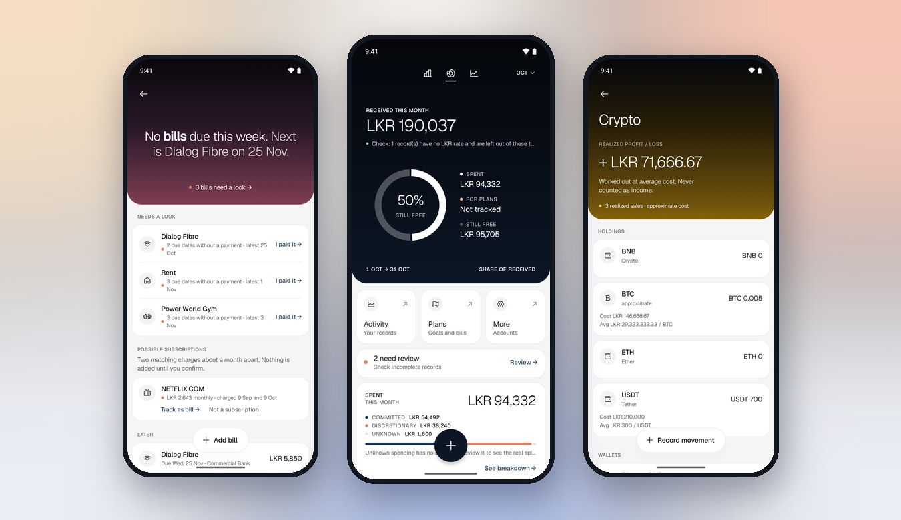

<div align="center">


# Zar

**Personal finance for irregular income.**

An Android app for Sri Lankan users that captures bank SMS, tracks bills, freelance work and crypto, and counts only money that actually arrived.

[](https://kotlinlang.org)
[](https://developer.android.com)
[](https://developer.android.com/compose)
[](https://firebase.google.com)
[](#architecture)

[Demo](docs/evidence/kavindu-live-demo/README.md) · [Features](#features) · [Setup](#run-locally) · [Contributing](#contributing)



<sub>Screens from the Android app with seeded demo data on the Firebase emulators.</sub>

</div>

## Features

- **Honest totals:** Home separates money received from money spent. Opening balances and expected payments never count as received, and incomplete data is flagged instead of guessed.
- **Bank SMS capture:** new bank messages and shared text become drafts you review before anything is saved. Commercial Bank, Sampath Bank and DFCC Bank formats are tested; other banks go to manual review. See [SMS compatibility](docs/sms-compatibility.md).
- **AI quick notes:** a typed note becomes an editable draft for review.
- **Activity and accounts:** browse and correct income, expenses and transfers across accounts, with [exchange rates](docs/exchange-rates.md) saved on foreign-currency records.
- **Bills:** recurring schedules, due-date checks, payment reminders and subscription suggestions that are added only when you confirm.
- **Freelance:** projects and milestones, with expected money kept out of received income until it is paid.
- **Crypto:** holdings and realized profit or loss at average cost, never counted as income.
- **Plans:** a savings goal backed by real account balances, plus a weekly allowance.
- **Catch-up and rules:** a weekly catch-up for cash and unresolved records, and remembered category rules for merchants.
- **Privacy and export:** hide amounts on screen, and export actual transactions and expected payments as separate CSV files.

## Current state

The features above are built on Jetpack Compose with Material 3, MVVM, Hilt, Firebase (Auth, Firestore, App Check), Room, DataStore, WorkManager and type-safe Navigation Compose. Minimum SDK is 26 and target SDK is 36.

`features/settings` is a small reference slice showing the full path: `SettingsScreen` → `SettingsViewModel` → `ObserveAppPreferencesUseCase` → `AppPreferencesRepository` (domain interface) → `ReportingCurrencyPreferencesRepository` (data), bound in `di/RepositoryModule`. Copy this shape for new features.

## Architecture

| Path | What it holds |
|---|---|
| `app/` | The Android app (Gradle module `:app`) |
| `benchmark/` | Macrobenchmarks for the app's `benchmark` build type (Gradle module `:benchmark`), not shipped |
| `worker/` | Cloudflare Worker behind AI quick notes |
| `functions/` | The earlier Firebase callable for quick notes, kept as a historical reference |
| `firestore.rules`, `firestore-tests/` | Firestore security rules and their tests |
| `tools/`, `scripts/` | Evaluation, measurement, seeding and brand asset scripts |

The app is one module, organised by feature:

```text
app/src/main/java/com/example/zar/
├── MainActivity.kt
├── ZarApplication.kt
├── core/
│   ├── domain/
│   │   ├── calculation/
│   │   ├── model/
│   │   ├── repository/
│   │   └── usecase/
│   ├── data/
│   │   ├── local/
│   │   └── remote/
│   ├── presentation/
│   │   ├── components/
│   │   ├── format/
│   │   ├── haptics/
│   │   ├── motion/
│   │   ├── privacy/
│   │   └── theme/
│   └── navigation/
├── di/
└── features/
    └── <feature>/
        ├── presentation/
        ├── domain/
        └── data/
```

| Folder | Put this code here |
|---|---|
| `presentation` | Compose screens, ViewModels and screen state |
| `domain` | Models, use cases, calculations and repository interfaces |
| `data` | Repository implementations, database/API access and data mapping |
| `core` | Code genuinely shared by multiple features |
| `di` | Hilt modules that connect interfaces and implementations |

Screens call ViewModels, which call domain use cases. Use cases depend on repository interfaces; the data layer implements them. Domain code must not import Android, Firebase, Compose or Room. Presentation must not access databases or external APIs directly.

Add smaller packages such as `model`, `usecase`, `repository`, `screen` and `viewmodel` within a feature when its code needs them. Empty directories have `.gitkeep` files so Git preserves the scaffold; remove a placeholder when adding real code.

## Feature ownership

| Features | Main owner |
|---|---|
| `auth`, `accounts`, `settings`; shared foundation and AI service | Dulain |
| `freelance`, `crypto`, `bills`, `capture`; received-income work in `transactions` | Luchitha |
| `transactions`, `quicknote`; capture review UI | Sanuk |
| `home`, `plans`, `allowance`, `export`; masking in `settings` | Sumuditha |

`features/` also contains `catchup`, `rates`, `reminders`, `rules` and `spending`. Their owners are not recorded here yet.

## Run locally

Requirements: a recent Android Studio, JDK 17 or newer, and **Android SDK Platform 37.1** (SDK Manager → SDK Platforms). The project compiles against SDK 37.1; the app still targets SDK 36 and runs on Android 8.0 (API 26) and up. The Gradle daemon runs on JDK 21, which Gradle downloads if it is missing.

1. Clone the repository and open its root folder in Android Studio.
2. Let Android Studio configure the local Android SDK and sync Gradle.
3. Get the team's `google-services.json` for Firebase project `zar-app-35602` privately and place it in `app/` (optional for building — see below).
4. Run the `app` configuration on an emulator or device.

Use the committed Gradle wrapper:

```bash
./gradlew assembleDebug        # build
./gradlew testDebugUnitTest    # unit tests, including the domain-purity check
```

### Testing against the Firebase emulators

Sign-in and data tests run against the local Firebase Emulator Suite, never the live project. With an Android emulator running:

```bash
npx -y firebase-tools@latest emulators:exec --only auth,firestore "./gradlew connectedDebugAndroidTest -Pzar.useEmulators=true"
```

`-Pzar.useEmulators=true` makes a debug or benchmark build use the emulators (`BuildConfig.USE_FIREBASE_EMULATORS`): Auth on port 9099 and Firestore on port 8080. Normal builds always use the live project, and release builds ignore the property.

The default emulator host, `10.0.2.2`, only works from an Android emulator. For a physical phone, run `adb reverse tcp:9099 tcp:9099` and `adb reverse tcp:8080 tcp:8080`, then also pass `-Pzar.emulatorHost=127.0.0.1`.

Other Gradle properties:

| Property | What it does |
|---|---|
| `zar.quickNoteEndpoint` | Public Worker URL for AI quick notes, set in `gradle.properties` |
| `zar.appIdSuffix` | Installs a debug or benchmark build beside the real app, for example `.perf` |
| `zar.coverage` | Set to `true` to enable the unit test coverage report on debug builds |

Without `app/google-services.json` the build still succeeds and prints a warning, but Firebase is not initialised, so any screen that injects `FirebaseAuth` or `FirebaseFirestore` will crash at runtime. Never commit that file.

Machine paths, IDE files, build output, Firebase configuration and credentials are ignored. Privileged AI/service keys belong on the backend.

## Shared domain contracts

Models, repository interfaces, saving rules and total calculations shared by every feature are described in [docs/domain-contracts.md](docs/domain-contracts.md). Read it before saving or totalling money.

AI quick notes use OpenRouter through a Cloudflare Worker. Deployment, Firebase authentication/App Check, secrets, Android configuration and evaluation are in [docs/openrouter-quick-notes.md](docs/openrouter-quick-notes.md). Worker checks run with `npm ci && npm run check && npm test` in `worker/`. The original [Gemini feasibility results](docs/ai-quick-notes-feasibility.md) and [Firebase callable](docs/ai-quick-notes-service.md) remain as historical references.

## Layer rules

- `DomainLayerPurityTest` fails if any file under a `domain` package imports `android.*`, `androidx.*`, `com.google.firebase.*` or `dagger.*`. Use `javax.inject.Inject` in domain classes.
- Bind each new repository interface to its implementation in `di/RepositoryModule`.
- Inject Firebase objects (from `di/FirebaseModule`) only into `data` classes.
- Add new destinations to `core/navigation/ZarRoutes.kt` and `ZarNavHost.kt`.
- Firestore rules live in `firestore.rules`; run `npm install && npm test` in `firestore-tests/` (needs Java) after changing them, and deploy with `npx -y firebase-tools@latest deploy --only firestore:rules`.

## Contributing

This is a private team project for SE3092, and work is tracked in the [Jira backlog](#team-backlog).

1. Branch from the latest `main`.
2. Follow the [layer rules](#layer-rules) and run `./gradlew testDebugUnitTest`. Run the [emulator tests](#testing-against-the-firebase-emulators) when sign-in or stored data changes.
3. Open a PR using the [template](.github/pull_request_template.md). PRs that change the UI need screenshots from the running app, as described in [AGENTS.md](AGENTS.md).
4. Review with `/pr-review <PR-number-or-URL>` in Claude Code or `$pr-review <PR-number-or-URL>` in Codex. The workflow is in [.agents/skills/pr-review/SKILL.md](.agents/skills/pr-review/SKILL.md).

## Jira feature command

Run a Jira task through OpenSpec planning, Sonnet 5.5 implementation in a separate worktree, Figma verification, one commit per completed task, and a PR using the repository template:

- **Claude Code:** `/jira-feature SCRUM-42`
- **Codex:** `$jira-feature SCRUM-42` (or select `jira-feature` with `/skills`).

Both accept a Jira URL, an optional Figma selection URL and `base=<branch>`. The default base is the latest `origin/main`.

The shared workflow is in [.agents/skills/jira-feature/SKILL.md](.agents/skills/jira-feature/SKILL.md). Jira, Figma for UI tasks, OpenSpec and GitHub access must be available. In T3, it discovers the exact Sonnet 5.5 model from the provider catalog. Native Claude Code can use the included Sonnet worker; Codex needs a Claude delegation provider such as T3. If that provider is unavailable, the command reports the blocker instead of switching models. Restart the agent session if the new command is not listed.

OpenSpec plans remain git-ignored. UI PRs include screenshots captured from the running app. Invocation includes feature commits, pushing and PR creation; merging and deployment are separate actions.

## Team backlog

[Jira backlog](https://03dulain.atlassian.net/jira/software/projects/SCRUM/boards/1/backlog) · [Approved wireframes](https://www.figma.com/design/p5SITMwzIDaa76eHLI3zB0/Places-App?node-id=91-2)

Home, Plans and trust feature submission material: [U10 report section](docs/U10-home-plans-trust-report.md) and [three-minute demo walkthrough](docs/U10-demo.md).

Kavindu Silva live demo account: [synthetic data and walkthrough](docs/demo-kavindu-account.md), with [running-app screenshots](docs/evidence/kavindu-live-demo/README.md).

Keep received money separate from expected payments. Transfers are not income or spending. Feature freeze: 22 October 2026. Submission: 30 October 2026.
