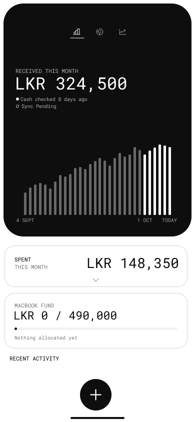
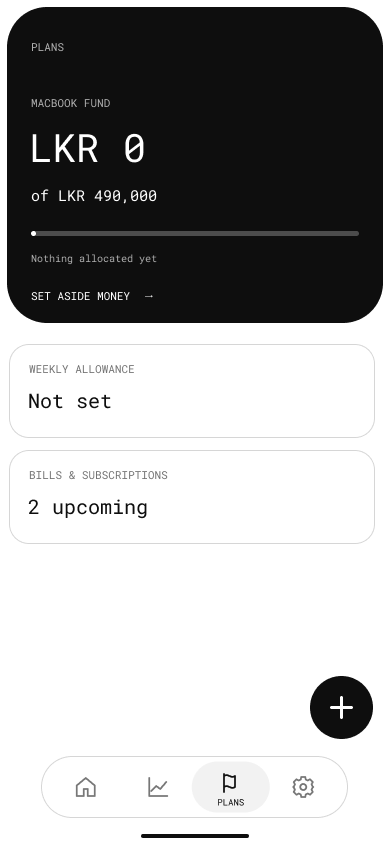

# U10 — Home, Plans and trust features

Jira: [SCRUM-53](https://03dulain.atlassian.net/browse/SCRUM-53) · Depends on [SCRUM-52](https://03dulain.atlassian.net/browse/SCRUM-52) · Demo: [U10 walkthrough](U10-demo.md)

This is the Home/Plans section for the team report. It describes the recorded behavior and the evidence for it; the figures in the Figma wireframes are examples, not the app's calculated values. The two wireframe PNGs below were exported unchanged from the [Zar UI Wireframes page](https://www.figma.com/design/bBBJuQz1Cg8N34FcisKBs9/Zar-UI?node-id=0-1) on 29 October 2026. The numbered annotations refer to exact Figma layers. Running-app evidence is listed separately.

## Annotated Home wireframe

| Annotation | Wireframe layer | What the implemented screen means |
| --- | --- | --- |
| 1. Received hero | [Received money / hero `1:105`](https://www.figma.com/design/bBBJuQz1Cg8N34FcisKBs9/Zar-UI?node-id=1-105) | **Received** is saved `INCOME` in the selected month. An opening balance, transfer, refund or expected payment is not income. The bar chart is the daily received series, not a balance forecast. |
| 2. Spending card | [Spent this month `1:155`](https://www.figma.com/design/bBBJuQz1Cg8N34FcisKBs9/Zar-UI?node-id=1-155) | **Spent** is net actual expense, split into committed, discretionary and unknown. A linked refund reduces its original purchase; an undo removes the entry. Cash catch-up outflows are flagged as unknown spending. |
| 3. MacBook fund | [Fund card `1:159`](https://www.figma.com/design/bBBJuQz1Cg8N34FcisKBs9/Zar-UI?node-id=1-159) | The implemented Home card links to Plans with “View your goals in Plans”; it does not display live backed progress. Plans calculates backing from explicit allocations and recorded account balances. The wireframe's `LKR 0 / 490,000` is sample copy. |
| 4. Freshness and activity | [Status `1:143`](https://www.figma.com/design/bBBJuQz1Cg8N34FcisKBs9/Zar-UI?node-id=1-143) · [Recent activity heading `1:166`](https://www.figma.com/design/bBBJuQz1Cg8N34FcisKBs9/Zar-UI?node-id=1-166) | Recent activity is the newest three active entries. Home keeps commitment and allowance loading/errors separate so one failed card does not hide the main totals. The app does not turn a last-recorded date into a bank-sync claim. |

## Annotated Plans wireframe

| Annotation | Wireframe layer | What the implemented screen means |
| --- | --- | --- |
| 1. MacBook hero | [Goal hero `1:486`](https://www.figma.com/design/bBBJuQz1Cg8N34FcisKBs9/Zar-UI?node-id=1-486) | An allocation is an instruction to reserve funds, not a new transaction. Known backing for each account is the smaller of its allocation and its nonnegative recorded balance. |
| 2. Gap and pace | [Goal state `1:493`](https://www.figma.com/design/bBBJuQz1Cg8N34FcisKBs9/Zar-UI?node-id=1-493) | The implemented progress card also shows allocation gap, target shortfall and weekly pace when they can be calculated. Pace rounds up to the smallest currency unit for the remaining days. |
| 3. Weekly allowance | [Allowance card `1:495`](https://www.figma.com/design/bBBJuQz1Cg8N34FcisKBs9/Zar-UI?node-id=1-495) | The optional limit subtracts this week's eligible discretionary spending. It starts off; committed bills, transfers, goal allocations and income do not consume it. |
| 4. Bills | [Bills card `1:498`](https://www.figma.com/design/bBBJuQz1Cg8N34FcisKBs9/Zar-UI?node-id=1-498) | Bills are expected commitments until an actual payment is linked. They do not inflate Received or Spent merely because they are scheduled. |

The original wireframes predate later visual changes. The [current Plans design frame `64:1814`](https://www.figma.com/design/bBBJuQz1Cg8N34FcisKBs9/Zar-UI?node-id=64-1814) has the 420 dp hero and other-plan rows; the app's additional goal-progress card is described in the [round-two comparison](evidence/pixel6a-feedback/round2/README.md). These annotations explain financial meaning, not pixel parity.

## Calculation and test evidence

| Claim | Source of calculation | Relevant checks |
| --- | --- | --- |
| Home counts actual income and net spending in the selected month; corrections, voids and missing rates change the displayed result without guessing. | [`LedgerSummaryCalculator`](../app/src/main/java/com/example/zar/core/domain/calculation/LedgerSummaryCalculator.kt), [`ObserveHomeOverviewUseCase`](../app/src/main/java/com/example/zar/features/home/domain/usecase/ObserveHomeOverviewUseCase.kt) | [`ObserveHomeOverviewUseCaseTest`](../app/src/test/java/com/example/zar/features/home/ObserveHomeOverviewUseCaseTest.kt): income only, spending classes, refunds, corrections/undo, missing rates, cash catch-up, daily chart and live updates. |
| A goal's backed amount is limited by allocation and recorded balance. Unknown, mismatched, future-opening or missing accounts cannot support an exact shortfall or pace. | [`GoalBackingCalculator`](../app/src/main/java/com/example/zar/features/plans/domain/model/BackedGoalProgress.kt) | [`GoalBackingCalculatorTest`](../app/src/test/java/com/example/zar/features/plans/GoalBackingCalculatorTest.kt): caps, negative balances, corrections, future funds, unknown balances, rounding, zero allocation and balance freshness. The last two were added for SCRUM-52. |
| The allowance is discretionary spending for the chosen week and categories, net of linked refunds. Unclassified entries, unvalued entries/refunds and cash catch-up outflows produce coverage warnings. | [`AllowanceCalculator`](../app/src/main/java/com/example/zar/features/allowance/domain/AllowanceCalculator.kt) | [`AllowanceCalculatorTest`](../app/src/test/java/com/example/zar/features/allowance/AllowanceCalculatorTest.kt): exclusions, overspending, coverage, corrections, refunds, week boundaries and no rollover. |
| Masking changes the display while exports retain the real values. Actual transactions and expected payments are separate CSV files. | [`AmountPrivacyViewModel`](../app/src/main/java/com/example/zar/core/presentation/privacy/AmountPrivacyViewModel.kt), [`BuildExportUseCase`](../app/src/main/java/com/example/zar/features/export/domain/usecase/ExportUseCases.kt) | [`AmountPrivacyTest`](../app/src/test/java/com/example/zar/core/presentation/privacy/AmountPrivacyTest.kt) and [`ExportUseCasesTest`](../app/src/test/java/com/example/zar/features/export/ExportUseCasesTest.kt). The [domain contract](domain-contracts.md) records CSV safety and exclusion rules. |

The author recorded the following check on the original SCRUM-52-based branch before the stack was rebased onto current main: `.\gradlew.bat testDebugUnitTest --console=plain` passed on 29 October 2026: **1,253 tests, zero failures, zero skipped** (122 JUnit XML suites). This is a JVM run; it is not an Android or live-service run.

## Incomplete data is visible

- A transaction without an LKR reporting rate increases the total's unresolved count; the app does not invent an exchange rate. Unknown spending and cash adjustments are identified rather than silently classified. [Domain rules](domain-contracts.md#money-rules)
- A goal can show known backing while withholding exact gap, shortfall and pace if any allocated backing account has an unknown or mismatched balance. Approximate opening funds are labelled as estimates. Its **balance as of** date is the oldest last-recorded date among backing accounts, not a bank-sync timestamp. [Goal behavior](u05-backed-goal-progress.md)
- An allowance warning explains excluded unclassified, unvalued or catch-up spending. Its remaining amount is therefore known spending against the limit, with coverage shown alongside it. [Allowance rules](domain-contracts.md#weekly-allowance-allowancecalculator)
- Home's owed/bill and allowance cards load independently of totals. A failure in one shows its own error state; it cannot erase an otherwise valid Home summary. [`HomeViewModel`](../app/src/main/java/com/example/zar/features/home/presentation/viewmodel/HomeViewModel.kt)

## Responsibilities and handoff

| Layer | Responsibility and concrete path |
| --- | --- |
| Presentation | [`HomeScreen`](../app/src/main/java/com/example/zar/features/home/presentation/screen/HomeScreen.kt) and [`PlansScreen`](../app/src/main/java/com/example/zar/features/plans/presentation/screen/PlansScreen.kt) render state. Their [Home](../app/src/main/java/com/example/zar/features/home/presentation/viewmodel/HomeViewModel.kt) and [Plans](../app/src/main/java/com/example/zar/features/plans/presentation/viewmodel/PlansViewModel.kt) ViewModels collect use cases and handle loading, errors and user actions. |
| Domain | Home summary, goal backing, allowance and export use cases apply the money rules. Repository interfaces sit in `core/domain/repository` or each feature's `domain/repository`, and domain calculations do not depend on Android or Firebase. |
| Data | Firestore repositories read/write account, ledger, goal and allowance records; the privacy choice is device-local. [`ContentResolverExportFileWriter`](../app/src/main/java/com/example/zar/features/export/data/ContentResolverExportFileWriter.kt) writes to the location the user picks. |
| Wiring | [`RepositoryModule`](../app/src/main/java/com/example/zar/di/RepositoryModule.kt) binds domain interfaces to data implementations with Hilt. The Home and Plans screens do not query Firestore directly. |

## Running-app evidence and limits

| State | Existing evidence and provenance |
| --- | --- |
| Home with commitments and an error state | [Populated Home](evidence/U03/02-home-clients-and-next-bill-populated.png), [commitments error](evidence/U03/03-home-commitments-error.png). These are historical U03 captures; their device/date are not recorded beside the files. |
| Backed goal and saving pace | [Backed amount and gap](screenshots/u05-plans-shortfall.png), [pace](screenshots/u05-plans-pace.png), [unknown balance at large text](screenshots/u05-plans-large-text.png). U05 describes these as deterministic Pixel 6a Compose fixtures, not real accounts. |
| Allowance and incomplete coverage | [Home remaining](evidence/U06-review/06-home-remaining.png), [Home overspent with warnings](evidence/U06-review/07-home-overspent-coverage.png), [Plans remaining](evidence/U06-review/02-plans-remaining.png). Captured from the running app on a Pixel 6a emulator on 24 October with fixed fixture data; [details](evidence/U06-review/README.md). |
| Masked money | [Home and chart masked](evidence/U07/01-home-hidden.png), [settings switch](evidence/U07/06-settings-hidden.png), [edit field fixed-width mask](evidence/U07/review/05-edit-entry-hidden.png). Pixel 6a emulator captures from 24–25 October; [details](evidence/U07/README.md). |
| Separate CSV export | [Export screen](evidence/u08-csv-export/export-screen.png), [system file picker](evidence/u08-csv-export/file-picker.png), [saved confirmation](evidence/u08-csv-export/saved-confirmation.png). These are existing U08 captures; the device and capture date are not documented with the files. |

No new Android screenshots were taken for U10 because no emulator or device was attached during this report run. The linked captures are evidence from earlier feature work, not a claim that this report rehearsed the full flow. The [walkthrough](U10-demo.md) lists the live observations to confirm before submission.
