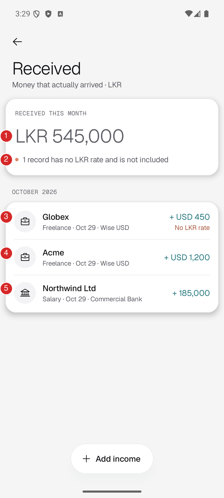
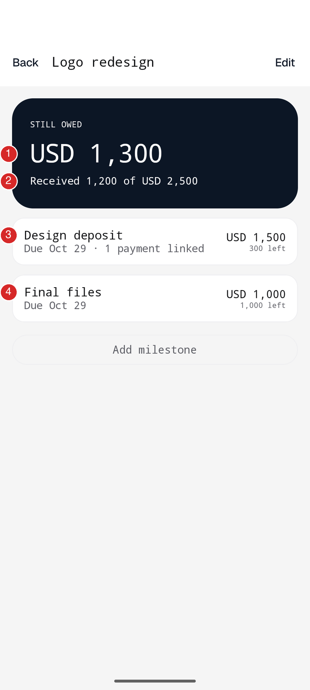
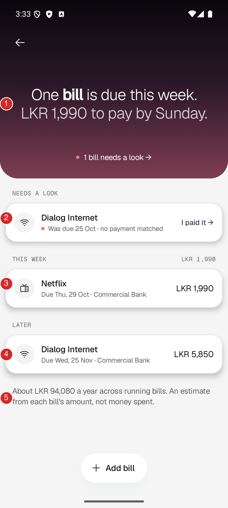
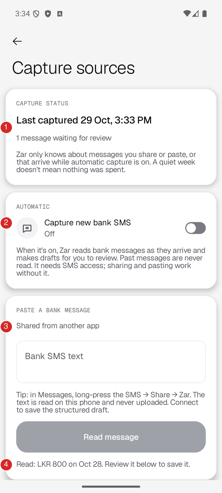
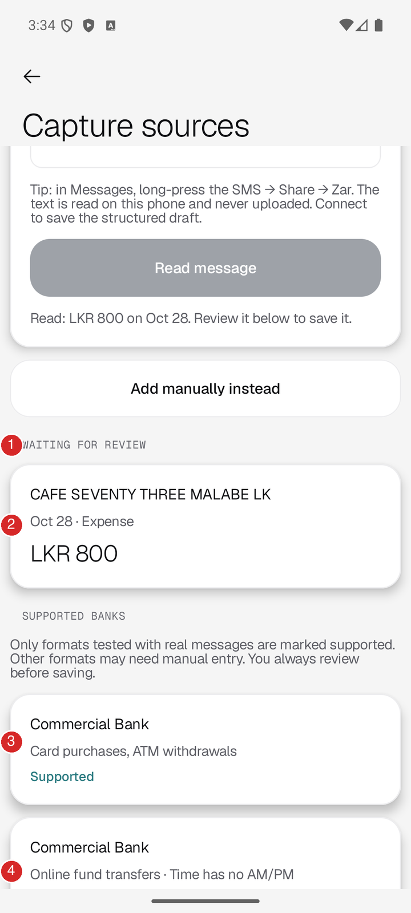
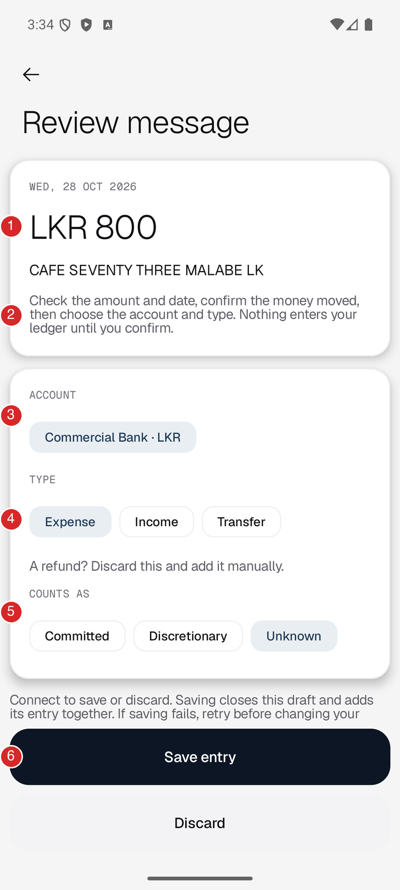
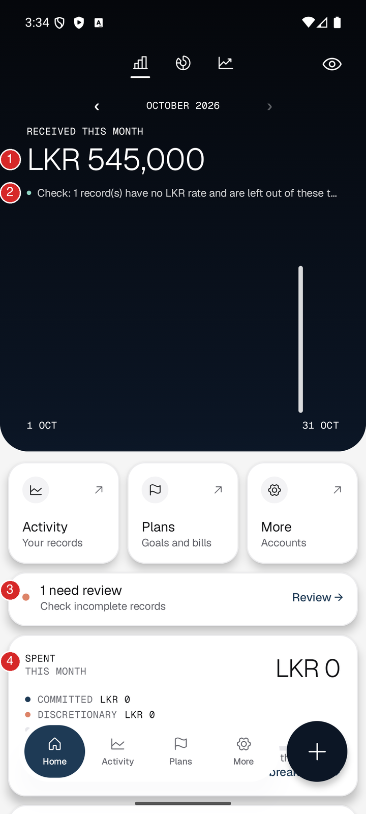
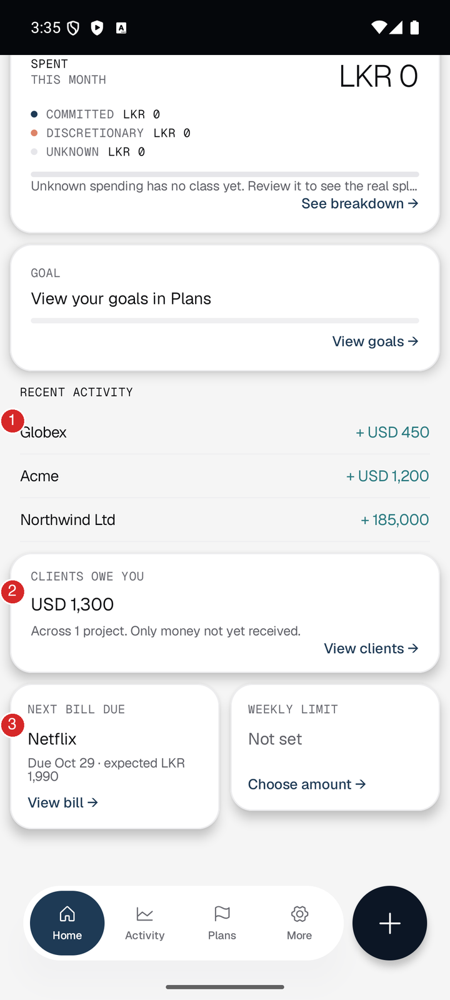
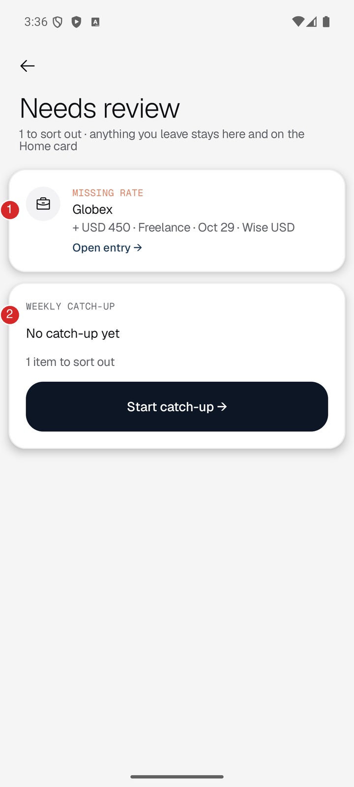

# L11 (SCRUM-34): income, bills and bank capture

Report section for Luchitha's area. Screens in this section were captured on 29 Oct 2026 from the running debug app on a Pixel 8 emulator (API 36) with the Firebase emulators and seeded test data. The short demo is in [L11-demo-script.md](L11-demo-script.md).

## 1. Overview

| Ticket | Jira | PR | What it delivered | Evidence |
|---|---|---|---|---|
| L01 | SCRUM-24 | #3 | Bank SMS compatibility findings | [sms-compatibility.md](../sms-compatibility.md) |
| L02 | SCRUM-25 | #6 | Received income in LKR and USD, rate saved at save time, edit and undo | [L02](../evidence/L02) |
| L03 | SCRUM-26 | #7 | Freelance projects, milestones, linked receipts, "clients owe you" | [L03](../evidence/L03) |
| L04 | SCRUM-27 | #20 | Crypto buy, sell, trade, move, average-cost profit | [L04](../evidence/L04) |
| L05 | SCRUM-28 | #21 | Bills, due dates, matching a payment to a due date | [L05](../evidence/L05) |
| L06 | SCRUM-29 | #24 | Subscription suggestions and cancellation | [L06](../evidence/L06) |
| L07 | SCRUM-30 | #23 | Bill and milestone reminders | [L07](../evidence/L07) |
| L08 | SCRUM-31 | #26 | Automatic SMS capture (off by default) | [L08](../evidence/L08) |
| L09 | SCRUM-32 | #22 | Share and paste SMS capture, review before saving | [L09](../evidence/L09) |
| L10 | SCRUM-33 | #38 | Tests for this area | [L10](../evidence/L10/README.md) |
| L11 | SCRUM-34 | this branch | This report, the demo script and annotated screens | [L11](../evidence/L11) |

Owner of all tickets: Luchitha. Code lives in `features/transactions` (income), `features/freelance`, `features/crypto`, `features/bills`, `features/reminders` and `features/capture`, on top of `core/domain`.

Three rules shape the whole area:

1. **Received means money that arrived.** Expected payments (milestones, bills), unexplained credits and transfers never count as Received.
2. **Nothing is guessed.** A missing LKR rate, an unknown cost or an unreadable SMS stays visible as "missing" or goes to review.
3. **Nothing enters the ledger until the user confirms.** SMS capture only makes drafts.

## 2. Annotated screens

All images are in [docs/evidence/L11](../evidence/L11). The unmarked originals are in [raw](../evidence/L11/raw).

### 2.1 Received income

| # | What it shows |
|---|---|
| 1 | Received this month: LKR 545,000. This is the LKR salary (185,000) plus USD 1,200 at the saved rate of 300 |
| 2 | One record has no LKR rate and is left out of the total, not guessed |
| 3 | USD 450 with no rate: the row says "No LKR rate" |
| 4 | USD 1,200 with a rate. Its LKR value was fixed when it was saved |
| 5 | LKR salary into Commercial Bank |

### 2.2 Freelance project and milestones

| # | What it shows |
|---|---|
| 1 | Still owed, in the project's own currency: USD 1,300 |
| 2 | Received 1,200 of USD 2,500 expected |
| 3 | Milestone "Design deposit" has one linked payment, so 300 is left |
| 4 | Milestone "Final files" has nothing linked, so 1,000 is left |

### 2.3 Bills

| # | What it shows |
|---|---|
| 1 | Summary line for the week: one bill is due, LKR 1,990 |
| 2 | "Needs a look": Dialog Internet was due 25 Oct and no payment is matched. It does not say "unpaid" |
| 3 | This week: Netflix, LKR 1,990, due 29 Oct |
| 4 | Later: next Dialog Internet due date, 25 Nov |
| 5 | Yearly estimate, LKR 94,080. It is worked out from bill amounts and is not money spent |

### 2.4 Capture sources

| # | What it shows |
|---|---|
| 1 | Capture status: when something was last captured and how many drafts wait. Silence does not mean nothing happened |
| 2 | "Capture new bank SMS" is **off** by default |
| 3 | Text shared from another app arrives here. Paste also works |
| 4 | Result of reading the message: LKR 800 on 28 Oct, review it to save |

| # | What it shows |
|---|---|
| 1 | Drafts waiting for review |
| 2 | The shared Commercial Bank message as a draft: merchant, date, type, amount |
| 3 | Commercial Bank card purchases and ATM withdrawals: **Supported** |
| 4 | Commercial Bank online transfers: needs review because the time has no AM/PM |

### 2.5 Review before saving

| # | What it shows |
|---|---|
| 1 | Date and amount read from the SMS |
| 2 | Warning that nothing enters the ledger until the user confirms |
| 3 | Account chosen by the user (the card's last four digits are only a hint) |
| 4 | Expense or Income creates an entry after confirmation. Transfer links the message to an existing transfer leg and creates no money |
| 5 | "Counts as": Committed, Discretionary or Unknown |
| 6 | Save entry. Saving closes the draft and adds the entry together |

### 2.6 Home and Needs review

| # | What it shows |
|---|---|
| 1 | Received this month, the same LKR 545,000 as the income screen |
| 2 | Check line: one record without a rate is left out |
| 3 | "1 need review" card that opens Needs review |
| 4 | Spent this month is LKR 0: bills and milestones add nothing to Spent |

| # | What it shows |
|---|---|
| 1 | Recent activity shows the three income entries |
| 2 | Clients owe you: USD 1,300, one total per currency, never converted |
| 3 | Next bill due: Netflix, expected LKR 1,990 |

| # | What it shows |
|---|---|
| 1 | The USD 450 income with no rate, with a link to open and fix it |
| 2 | Weekly catch-up for the same unresolved item |

More screens for each ticket (partial payments, undo, wrong-currency accounts, reminders, expiry notice) are in the L02 to L09 evidence folders linked in section 1.

## 3. Domain and data

Layers follow the repository rules. Screens and ViewModels are in `presentation`. Models, use cases, calculations and repository interfaces are in `domain` and import nothing from Android or Firebase (`DomainLayerPurityTest` checks this). Repository implementations are in `data`. Hilt binds them in `di/RepositoryModule`. Screens never call Firestore or Room.

### 3.1 What each feature uses

| Feature | Domain (rules, use cases) | Stored in | Repository or worker |
|---|---|---|---|
| Income | `IncomeRules`, `RecordIncomeUseCase`, `EditIncomeUseCase`, `ObserveIncomeUseCase` | `users/{uid}/transactions`, type `INCOME`; edits in `corrections`; undo in `voids` | Shared `LedgerRepository` (Firestore) |
| Freelance | `FreelanceRules`, `FreelanceCalculator`, `SaveProjectUseCase`, `SaveMilestoneUseCase`, `LinkReceiptUseCase`, `ObserveOutstandingUseCase` | Projects in `users/{uid}/projects`. Milestones in `expectedPayments`. Receipt links in `paymentMatches` | `FirestoreProjectRepository` (`ProjectRepository`) |
| Crypto | `CryptoMovementRules`, `CryptoPortfolioCalculator`, `RecordCryptoMovementUseCase`, `SetOpeningCostUseCase` | Movements are transfers (two `transactions` legs). Opening cost in `users/{uid}/cryptoOpeningCosts/{accountId}` | `FirestoreOpeningCostRepository` (`OpeningCostRepository`) |
| Bills | `BillSchedule`, `BillRules`, `BillsCalculator`, `RecurrenceDetector`, `SaveBillUseCase`, `LinkBillPaymentUseCase`, `ConfirmSuggestionUseCase`, `SetBillCancellationUseCase` | Bills in `users/{uid}/bills`. A due date is saved in `expectedPayments` (id `bill-{billId}-{date}`) once a payment is linked | `FirestoreBillRepository` (`BillRepository`); dismissed suggestions in DataStore |
| Reminders | `ReminderPlanner`, `PlanRemindersUseCase`, `MarkRemindersShownUseCase` | This phone only: DataStore `payment_reminders` | `WorkManagerPaymentReminderScheduler`, `PaymentReminderWorker` |
| Capture | `BankSmsParser`, `CaptureTextUseCase`, `CapturedDraftRules`, `ConfirmCapturedDraftUseCase`, `StageIncomingSmsUseCase`, `ProcessStagedSmsUseCase` | Drafts in `users/{uid}/drafts` (structured fields only). Automatic capture stages text in the encrypted Room table `staged_sms` | `FirestoreDraftRepository`; `RoomSmsStagingRepository`; `SmsCipher`; `AutoCaptureWorker` |

Shared models are in `core/domain` and described in [domain-contracts.md](../domain-contracts.md). Firestore access is limited to the owner by `firestore.rules`; the original L10 run recorded 25 passing rules tests (see [L10](../evidence/L10/README.md) for dated results).

### 3.2 Money rules

- Amounts are `Money`: integer minor units for fiat (LKR 1,250.50 is `125050`) and exact decimals for crypto. No `Double`.
- Every ledger transaction stores a `ReportingConversion` to LKR at save time: `SameCurrency`, `Converted` (with the rate) or `Missing`.
- Income form: a rate applies only to foreign income. A blank rate means unknown and is stored as `Missing`. Rates must be positive (`IncomeRules`).
- A corrected amount keeps the stored historical rate. Changing the rate replaces the conversion.
- Totals return an amount and an `unresolvedCount`. When the count is above zero, the screen says a record has no rate.
- Dates are calendar days in `Asia/Colombo`.

### 3.3 What counts as Received

- **Received** is `INCOME` transactions only (`LedgerSummaryCalculator`).
- **Not Received:** milestones and bill due dates (expected payments), unexplained credits (drafts), refunds, transfers (including every crypto movement), opening balances and adjustments.
- Undone entries (void markers) are ignored everywhere.
- Edits are corrections appended to the original. Imported or typed facts are never overwritten.
- A milestone receipt is capped at the amount still unlinked, so one payment is never counted twice across milestones (`FreelanceCalculator`).
- A bill never posts an expense by itself. The user links the real payment to a due date.
- A bill cancelled from a date keeps its earlier due dates. "Planning to cancel" changes nothing until confirmed.

### 3.4 Capture and privacy

- The parser reads shared, pasted or received text on the phone and keeps only structured fields: amount, date, time, card or account hint, merchant and type.
- Shared text is held in memory only (`SharedTextInbox`).
- Automatic capture (`RECEIVE_SMS`) is off until the user turns it on. The receiver component is disabled in the manifest until then. Only messages that parse as a tested bank format are staged.
- Staged text is encrypted with AES-GCM using a key in the Android Keystore. The staging table is `staged_sms` in `CaptureStagingDatabase`.
- A WorkManager job turns staged messages into pending drafts when the phone is online (an extra pass runs every 12 hours). The staged text is deleted once processed.
- On a background pass, staged SMS text older than 7 days is deleted and an expiry notice is kept if it has not become a structured draft. Drafts already saved to Firestore do not expire under this rule. Turning capture off discards the signed-in user's waiting staged messages; it does not delete existing drafts.
- A message staged by one user is never processed for another user.
- Firestore never receives the raw SMS.

## 4. How it connects to Home and Needs review

| Where | What it reads | Source |
|---|---|---|
| Home: Received this month | `INCOME` entries of the month | `ObserveHomeOverviewUseCase` using `LedgerSummaryCalculator`, the same maths as `ObserveIncomeUseCase` |
| Home: Spent this month | `EXPENSE` entries net of linked refunds, capped at the purchase, plus `ADJUSTMENT_OUT` under Unknown | Bills, milestones and drafts add nothing; refunds reduce spending in the original purchase period |
| Home: Clients owe you | Unreceived milestone money, one total per currency | `ObserveHomeCommitmentsUseCase` using `ObserveOutstandingUseCase` |
| Home: Next bill due | Next bill due date, shown as expected | `ObserveHomeCommitmentsUseCase` using `ObserveNextBillUseCase` |
| Home: "need review" card and Needs review | Records that need attention, such as income with a missing rate | `features/catchup` (`UnresolvedRules`, kind `MISSING_RATE`) |
| Capture sources: waiting drafts | Pending drafts from shared, pasted or received SMS | `ObserveCapturedDraftsUseCase` |
| Review message screen | One draft: confirm, change type, or discard | `ConfirmCapturedDraftUseCase` |

How data flows:

1. Home reads the ledger through use cases, so adding income, linking a receipt or undoing an entry updates Received, Clients owe you and Next bill without a refresh, including offline.
2. Income with no rate raises the Home check line and a "Missing rate" item in Needs review. Adding the rate on the entry removes it and the total updates.
3. A captured SMS becomes a draft. In this build the draft is reviewed from **Capture sources** (the Review message screen), not from the Needs review list. The Needs review list shows unresolved ledger records, not drafts.
4. Confirming a draft as Expense or Income creates an entry and can change Spent or Received. Choosing Transfer links the draft to an existing transfer leg without adding a transaction. Linking a duplicate to an existing payment likewise adds only evidence. A draft never changes Home on its own.
5. Linking a recorded expense to a bill due date settles that due date. The expense counts in Spent once, and the bill due date adds nothing.

## 5. Test evidence

### 5.1 Automated tests (L10)

Historical author results from [L10](../evidence/L10/README.md), run on 29 Oct 2026. PR #38's later review integrated main and recorded 1,291 passing unit tests on 30 Oct; these are separate runs. No Android or Firestore tests were rerun for this documentation review.

| Command | Result |
|---|---|
| `./gradlew testDebugUnitTest` | 1,274 passed, 0 failed (24 new in L10) |
| `cd firestore-tests && npm test` | 25 out of 25 passed |
| Instrumented runs of `CaptureUiTest`, `BillsUiTest`, `AutoCaptureTest`, `CaptureRepositoryTest`, `IncomeSheetParityUiTest`, `IncomeCorrectionUiTest` | All 71 passed |

| Area | Unit tests | Instrumented tests |
|---|---|---|
| Income | 25 | 20 (`IncomeSheetParityUiTest` 19, `IncomeCorrectionUiTest` 1) |
| Bills and subscriptions | 41 | `BillsUiTest` 12 |
| Reminders | 9 | none |
| Freelance and milestones | 25 | none |
| Currencies | 17 (`CurrencyConverterTest` 5, `MoneyTest` 6, `MoneyFormatTest` 6) | none |
| Crypto | 23 | none |
| SMS parser | `BankSmsParserTest` 13 | none |
| Capture, manual and automatic | 100 | 39 (`CaptureUiTest` 23, `CaptureRepositoryTest` 10, `AutoCaptureTest` 6) |

These tests cover the money rules in section 3: minor-unit maths, rate stored at save time, missing rate as unresolved, due-date clamping at month end, cancellation, crypto average cost, parser formats, OTP and declined messages, and the capture switch.

### 5.2 Device and emulator evidence

| Ticket | Screenshots | What they prove |
|---|---|---|
| L02 | [6](../evidence/L02) | LKR income saved, USD income with a missing rate, adding the rate updates the total, undo |
| L03 | [6](../evidence/L03) | Project in USD, milestones, partial receipts, a receipt-only entry, Clients owe you, undo |
| L04 | [7](../evidence/L04) | Unknown opening cost, average-cost profit, Home Received and Spent unchanged, undo a sale, network fee |
| L05 | [9](../evidence/L05) | Monthly bill on the 30th, past due not matched, linking a payment, Spent counts only the real expense |
| L06 | [10](../evidence/L06) | Subscription suggestion, planning to cancel keeps due dates, confirmed cancellation keeps history |
| L07 | [8](../evidence/L07) | Permission asked when a reminder is chosen, refusal handled, one reminder per bill, overdue milestone alert once |
| L08 | [10](../evidence/L08) | Off by default, SMS access refusal, offline messages waiting encrypted, saved as drafts online, turned off, expiry notice |
| L09 | [6](../evidence/L09) | Shared SMS read, review before saving, a credit never assumed to be income, an OTP gives nothing to record |
| L10 | [6](../evidence/L10) | Bill, project and milestone screens still open after the argument refactor |
| L11 | [9 annotated](../evidence/L11) | The seeded demo account end to end (section 2) |

Seeded run for L11 on the Pixel 8 emulator (API 36), checked by hand against the numbers on screen:

| Check | Expected | Seen |
|---|---|---|
| Received this month | 185,000 + 1,200 × 300 = LKR 545,000 (USD 450 has no rate, so it is left out) | LKR 545,000 on the income screen and on Home |
| Clients owe you | 1,500 + 1,000 − 1,200 = USD 1,300 | USD 1,300 |
| Spent this month | Bills, milestones and the pending draft add nothing | LKR 0 |
| Next bill | Netflix, due 29 Oct, LKR 1,990 | Same |
| Yearly bill estimate | (5,850 + 1,990) × 12 = LKR 94,080 | LKR 94,080 |
| Shared Commercial Bank card SMS | Draft of LKR 800 on 28 Oct, not saved | Draft waiting for review |

The income form layout was also checked on a Pixel 6a phone in [income parity](../evidence/pixel6a-feedback/final-figma-alignment/income-parity/README.md). That run did not test SMS.

## 6. SMS formats and capture limits

### 6.1 Validated formats

From [sms-compatibility.md](../sms-compatibility.md). The messages are real, collected in October 2026 and anonymized. "Supported" means every sample was extracted correctly.

| Bank | Message type | Samples | Status |
|---|---|---|---|
| Commercial Bank | Card purchase | 9 | Supported |
| Commercial Bank | ATM withdrawal | 3 | Supported |
| Commercial Bank | Online fund transfer | 4 | Needs review: the time has no AM/PM, and "request" does not confirm the money moved |
| Commercial Bank | Money received | 0 | Unknown |
| Sampath Bank | Debits (POS, ATM, online, transfers) | 25 | Supported |
| Sampath Bank | Credits and reversals | 5 | Supported, but the user sets the type |
| DFCC Bank | Debits and fees | 6 | Needs review: no time in the message |
| DFCC Bank | Money received | 0 | Unknown |
| BOC, People's, HNB, NSB, NDB, Seylan, Nations Trust, others | Any | 0 | Unknown |

Messages that are not read as transactions:

- OTP messages, even when they contain an amount.
- Declined payments ("your card was declined").
- Anything that mentions money but is not a tested format. It is reported as not recognised and the user adds it manually.

### 6.2 Capture routes: actual results

| Route | Built | Tested | Result |
|---|---|---|---|
| Share to Zar (`ACTION_SEND`, text/plain) | Yes (L09) | Pixel 8 emulator, L09 and again for L11 with an `adb` share intent | A Commercial Bank card message became a draft. Nothing was saved until the user confirmed |
| Automatic capture (`RECEIVE_SMS`) | Yes (L08) | Pixel 8 emulator, messages sent with `adb emu sms send` | Off by default. Messages were staged encrypted, turned into drafts online, and discarded when capture was turned off |
| Paste into Capture sources | Yes (L09) | No separate paste run recorded | Uses the same reading code as share (`CaptureTextUseCase`) |
| Notification listener | No | No | Not built |
| Physical Android phone receiving a real bank SMS | n/a | No | Not tested |

### 6.3 Actual limitations

- **No real-phone SMS test.** All collected samples came from iPhones, where apps cannot read SMS. Automatic capture was only tried with emulator SMS. How real operators, dual-SIM phones, long messages and battery restrictions behave is unknown.
- **Few banks.** Only Commercial Bank card and ATM messages and Sampath messages are fully supported. DFCC and Commercial Bank transfers always need a check. Other banks go to manual entry.
- **No credit alerts** from Commercial Bank or DFCC have been seen, so incoming money from those banks is not parsed. A Sampath credit only has the sender's note, so the user must decide whether it is income, a transfer or a refund. Refunds must be discarded from capture review and recorded manually; the review screen does not offer a Refund type. Reversals are never income.
- **Foreign amounts.** No SMS with a USD amount has been seen, so foreign purchases are not validated. The only foreign sample was shown in LKR.
- **Raw merchant names.** Names keep country codes, terminal IDs and typos. Capture review does not edit the merchant, amount or date; discard an incorrect draft and add the payment manually.
- **Sharing is manual.** The user has to share each message. Zar cannot tell the difference between a quiet week and a missed message, so Capture sources shows the last capture time and never says "all caught up".
- **Automatic capture** needs the SMS permission and only sees new messages, never the inbox. It is off by default. Google Play restricts the SMS permission, so treat it as a demo feature. Saving a structured draft requires a connection. Staged text older than 7 days is deleted on a background pass with a notice if it has not become a draft; already-created drafts are not deleted by this rule.
- **Drafts are reviewed in Capture sources.** They do not appear in the Needs review list.
- **Rates are typed by the user.** There is no live exchange-rate service, so income in USD stays "missing rate" until a rate is entered. *Update (issue #46, 4 Nov 2026): the income and expense forms can now fill in today's rate. This report describes the state when it was written; see [exchange-rates.md](../exchange-rates.md).*
- **Reminders** run from a daily background job and need the notification permission. The exact minute is not guaranteed. If notifications are refused, no reminder is shown and the screen says so.
- **Subscription suggestions** appear only after two expenses with the same merchant, account, currency and exact amount, 25 to 35 days apart. Anything else is not suggested.
- **Test gaps** (from L10): one flaky capture UI test that passed on re-run, one lint error already on `main` in `PlansHero.kt`, no dark-mode or TalkBack pass, and no run against live Firebase (emulators only).

## 7. Future work

- Run the share and automatic capture routes on a physical Android phone with real messages.
- Collect samples from BOC, People's Bank, HNB and NSB, and credit alerts from Commercial Bank and DFCC.
- Collect an SMS with a USD amount before claiming foreign purchase support.
- Show captured drafts in the Needs review list as well.
- Clean merchant names (country codes, terminal IDs).
- Add a notification-listener route only if Google Play policy and the team agree it is worth the special access.
- Add an optional exchange-rate source that fills the rate field and still saves the rate used with each record. *Done in issue #46, see [exchange-rates.md](../exchange-rates.md).*
- Add UI tests for the freelance, crypto and reminder screens, which have unit tests only.
