# S09 (SCRUM-43): Add, Activity and cash catch-up

Report section for Sanuk's area. Screens in this section were captured on 29 Oct 2026 from the running debug app on a Pixel 4 emulator (Android 37.1) with the Firebase emulators and seeded test data. The short demo is in [S09-demo-script.md](S09-demo-script.md) and the recording is [demo-add-activity-catch-up.mp4](../evidence/S09/demo-add-activity-catch-up.mp4).

## 1. Overview

| Ticket | Jira | PR | What it delivered | Evidence |
|---|---|---|---|---|
| S01 | SCRUM-35 | #12 | Add menu, manual expenses and transfers | [S01](../evidence/S01) |
| S02 | SCRUM-36 | #14 | Activity list, correcting a record, undo (void) | [S02](../evidence/S02) |
| S03 | SCRUM-37 | #16 | Refunds linked to a purchase, cash and bank balance checks | [S03](../evidence/S03) |
| S04 | SCRUM-38 | #18 | Weekly cash catch-up, Needs review, the reminder | [S04](../evidence/S04) |
| S05 | SCRUM-39 | #27 | Remembering a precise merchant's category | [S05](../evidence/S05) |
| S06 | SCRUM-40 | #30 | Reviewing captured messages: possible duplicates, transfers | [S06](../evidence/S06) |
| S07 | SCRUM-41 | #29 | Quick note reviewed and saved as a record | [S07](../evidence/S07) |
| S08 | SCRUM-42 | #41 | Tests and offline evidence for the above | [S08](../evidence/S08/README.md) |
| S09 | SCRUM-43 | this branch | This report, the demo script and recording, annotated screens | [S09](../evidence/S09) |

Owner of all tickets: Sanuk. Code lives in `features/transactions` (Add, Activity, refunds, categories), `features/accounts` (balance checks), `features/catchup`, `features/rules`, `features/capture` and `features/quicknote`, on top of `core/domain` and `core/data`.

Three rules shape the whole area:

1. **A saved record is never edited or deleted.** A correction is a new record that points at the original, and undo is a void marker.
2. **Nothing is guessed.** An unexplained cash gap is saved as unknown spending, a bank credit is never assumed to be income, and a generic name such as PickMe is never filed by a remembered rule.
3. **Nothing is lost offline.** A save is kept on the phone at once, sent later under the same IDs, and a repeat cannot create a second record.

## 2. Annotated screens

Numbered red marks refer to the lists under each screen. The unmarked originals are in [docs/evidence/S09/raw](../evidence/S09/raw).

### 2.1 Add menu and manual entry

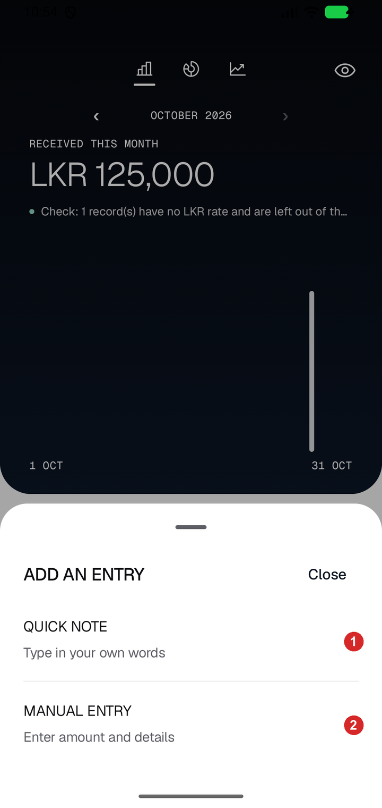 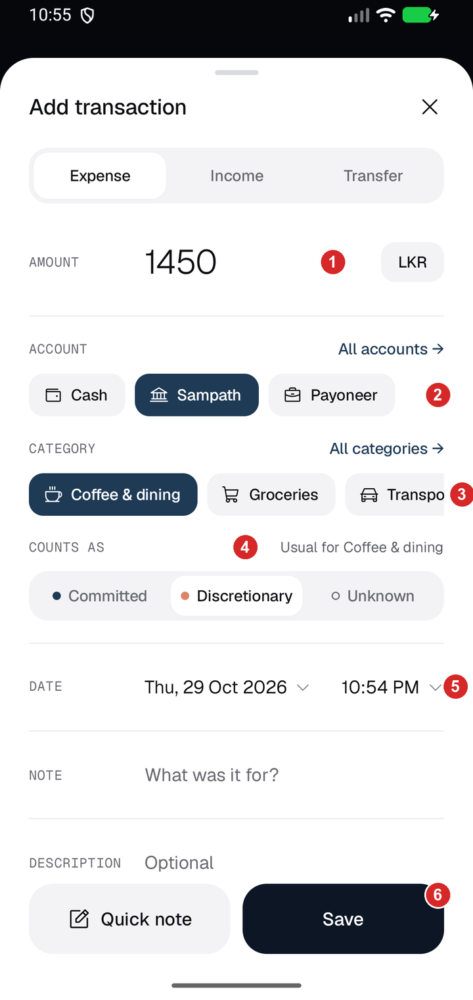 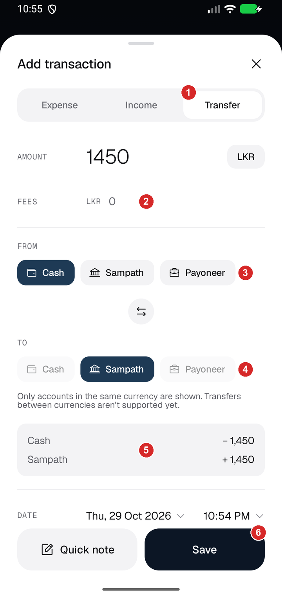

**Add menu.** 1. Quick note: type a sentence, Zar suggests records, nothing is saved until you confirm. 2. Manual entry: the form.

**Expense form.** 1. Amount, in the currency of the chosen account. 2. Account: Cash, Sampath or Payoneer. 3. Category chips; "All categories" opens the full list. 4. Counts as: Committed, Discretionary or Unknown. Choosing a category suggests one ("Usual for Coffee & dining") but you decide. 5. Date and time. 6. Save.

**Transfer form.** 1. The Transfer tab. 2. Optional fee. 3. From account. 4. To account: only accounts in the same currency are offered. 5. A preview of both legs (here Cash minus 1,450 and Sampath plus 1,450) before anything is saved. 6. Save writes both legs, and a fee if there is one, together.

### 2.2 Activity and an entry

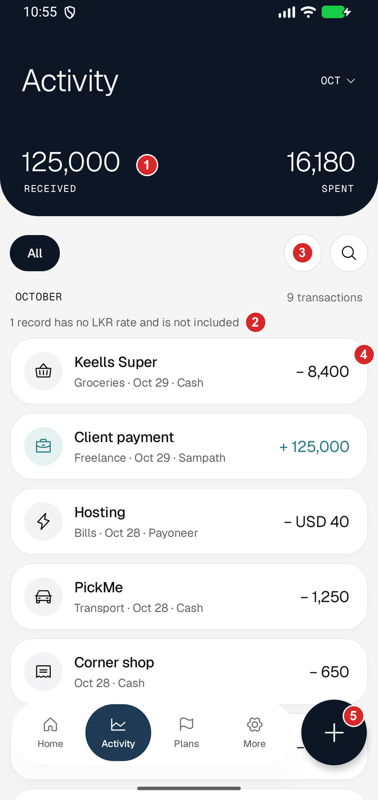 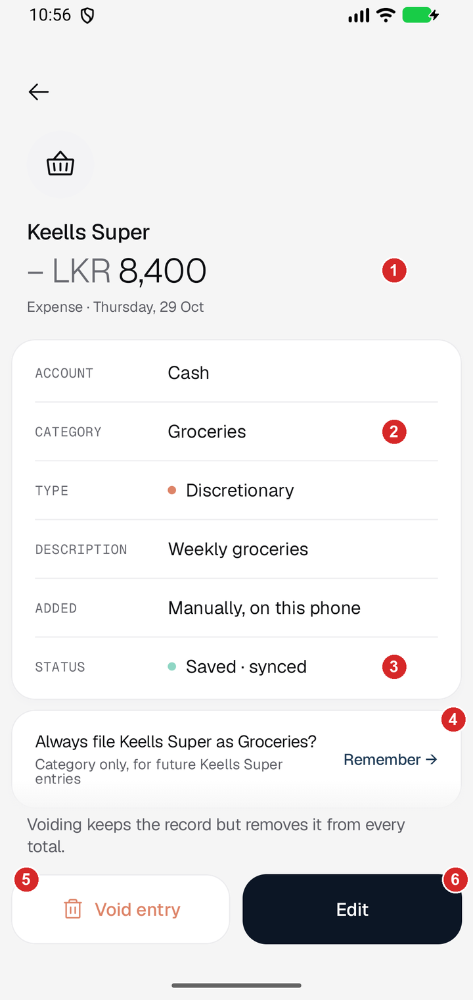

**Activity.** 1. Received and Spent for the month (125,000 and 16,180 here). 2. "1 record has no LKR rate and is not included": a USD entry without a rate stays visible and is left out of the totals, not counted as zero. 3. Filter. 4. A row: name, category, date, account and amount. 5. Add button.

**Entry detail.** 1. The amount. 2. Category. 3. Status "Saved · synced"; on a phone with no connection it says "Saved on this phone". 4. The offer to remember the category: "Category only, for future Keells Super entries". 5. Void entry keeps the record but removes it from every total. 6. Edit.

### 2.3 Correction and refund

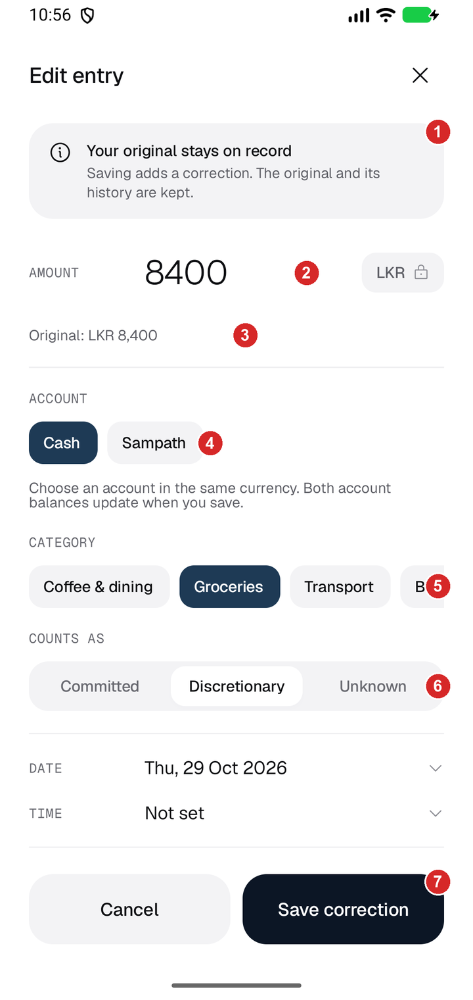 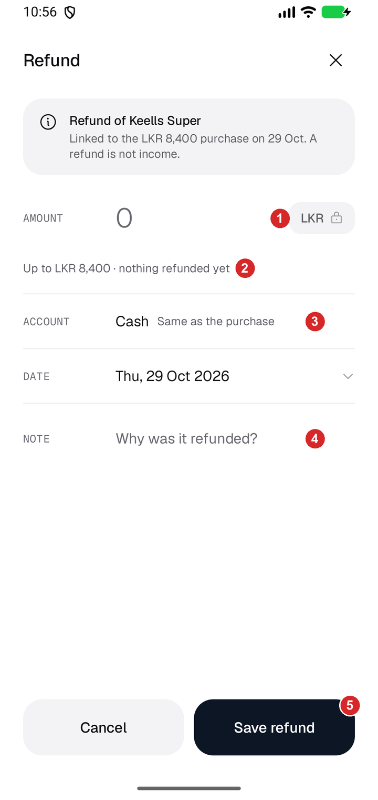

**Edit entry.** 1. "Your original stays on record." Saving adds a correction. 2. The new amount. 3. The original amount stays visible. 4. Account: only same-currency accounts, and not at all while refunds or a transfer are linked. 5. Category. 6. Counts as. 7. Save correction.

**Refund.** 1. The refund amount. 2. "Up to LKR 8,400 · nothing refunded yet": a refund cannot exceed the purchase. 3. The account is the purchase's account. 4. A note. 5. Save refund. A refund is not income.

### 2.4 Weekly cash catch-up

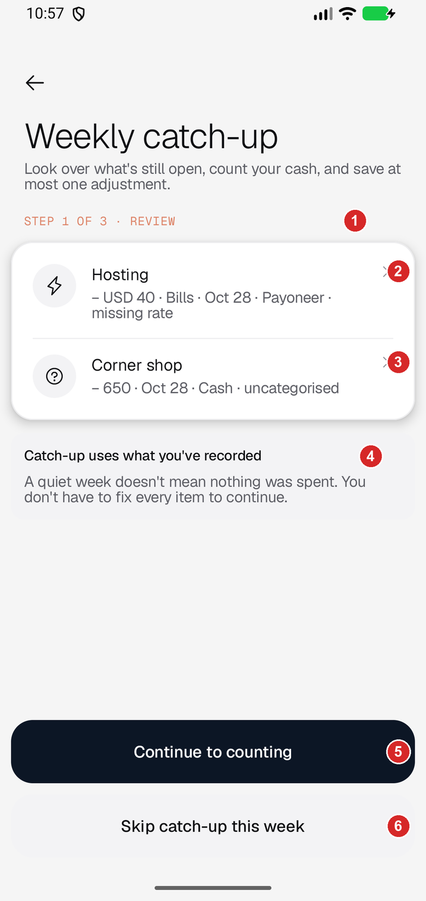 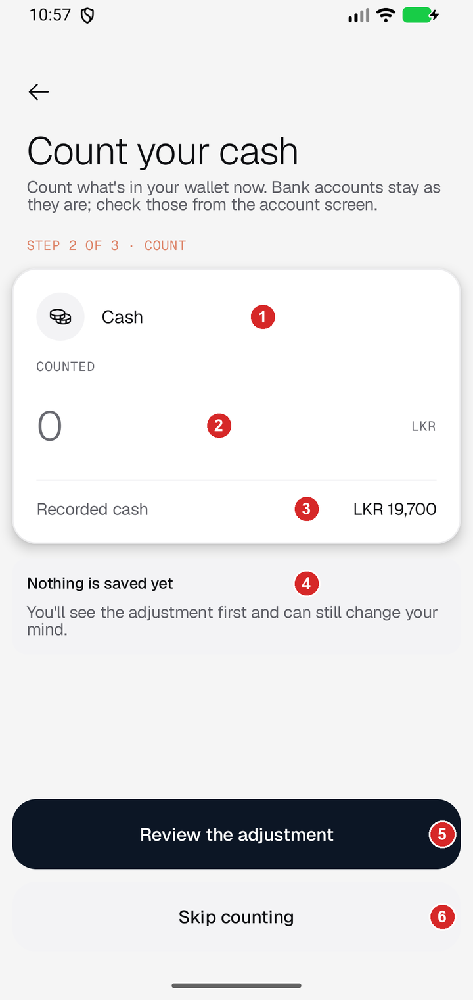 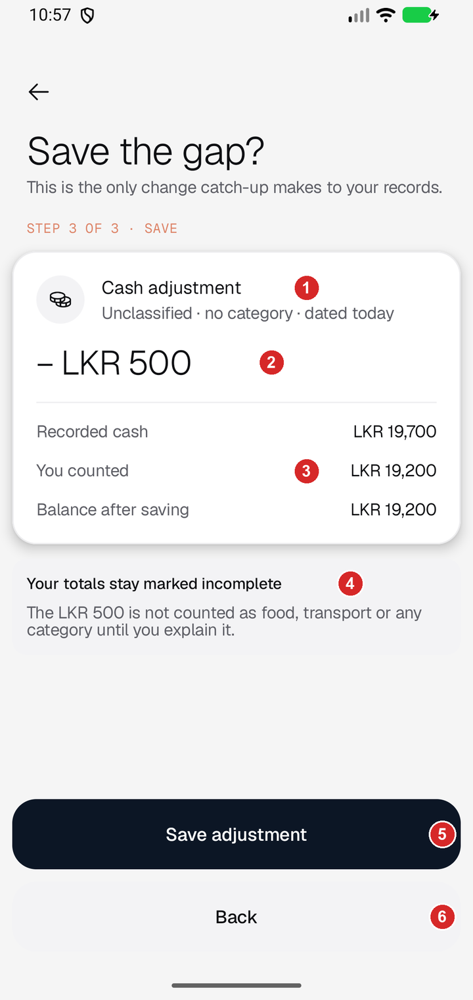 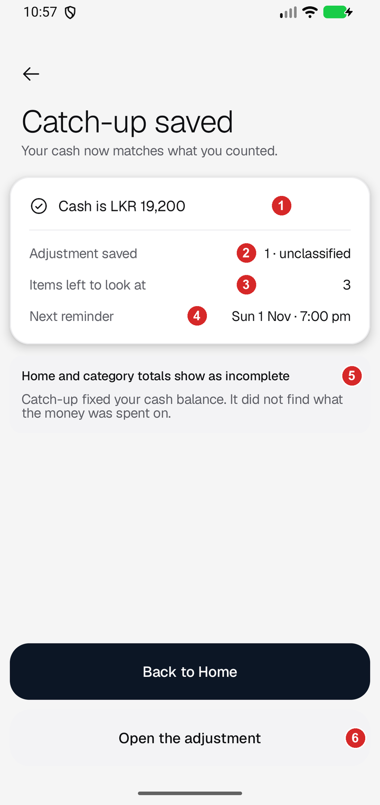

**Step 1, review.** 1. Step 1 of 3. 2. An entry with a missing rate. 3. An uncategorised cash expense. 4. "A quiet week doesn't mean nothing was spent. You don't have to fix every item to continue." 5. Continue. 6. Skip this week.

**Step 2, count.** 1. The cash account (bank accounts are checked from their own screen). 2. The cash you counted. 3. The recorded balance, here LKR 19,700. 4. "Nothing is saved yet." 5. Review the adjustment. 6. Skip counting.

**Step 3, save the gap.** 1. One adjustment: "Unclassified · no category · dated today". 2. The size of the gap, minus LKR 500. 3. Recorded 19,700, counted 19,200, balance after saving 19,200. 4. "Your totals stay marked incomplete": the LKR 500 is not counted as food, transport or any category until you explain it. 5. Save adjustment. 6. Back.

**Done.** 1. Cash is LKR 19,200. 2. One unclassified adjustment saved. 3. Items left to look at: 3 (the missing rate, the uncategorised expense and the adjustment itself). 4. The next reminder. 5. "Catch-up fixed your cash balance. It did not find what the money was spent on." 6. Open the adjustment.

### 2.5 Quick note

The review sheet and the failed read were not recaptured for this section. See the stills from the SCRUM-41 run in [docs/evidence/S07](../evidence/S07): write a note, reading, "Check before saving" with a paid record and an expected-not-paid record, editing a record, choosing the account, and the result on Home. [S08 screenshot 19](../evidence/S08/19-quick-note-failed-read-note-kept.png) shows a failed read: the note is kept, with "Fill the form" and "Try again". Screenshot [02](../evidence/S08/02-quick-note-offline-note-kept.png) shows the same offline.

## 3. Presentation, domain and data

| Layer | What it holds in this area | Example |
|---|---|---|
| Presentation | Compose screens and ViewModels. They hold what the screen shows and call use cases, never a database. | `ManualEntryViewModel`, `ActivityViewModel`, `EditEntryViewModel`, `EntryDetailViewModel`, `CatchUpViewModel`, `NeedsReviewViewModel`, `QuickNoteViewModel` |
| Domain | Models, use cases, rules and repository interfaces. It has no Android, Firebase or Dagger imports. | `RecordExpenseUseCase`, `SaveTransactionUseCase`, `CorrectTransactionUseCase`, `VoidTransactionUseCase`, `RecordBalanceCheckUseCase`, `RecordCatchUpUseCase`, `UnresolvedRules`, the `LedgerRepository` interface |
| Data | Implements the interfaces against Firestore, DataStore, WorkManager and the quick-note service. | `FirestoreLedgerRepository`, `DataStoreCatchUpPreferencesRepository`, `WorkManagerReminderScheduler`, `HttpQuickNoteDraftTransport` |
| Wiring | Hilt binds each interface to its implementation. | `RepositoryModule` (`@Binds`), `FirebaseModule` |

Saving the expense on screen 2.1 follows this path (read in the code): `ManualEntryViewModel` calls `RecordExpenseUseCase`, which calls `SaveTransactionUseCase`, which checks the account (not archived, same currency) and calls `LedgerRepository.saveTransaction`. The data layer's `FirestoreLedgerRepository` writes it.

The domain rule is enforced by a test: `DomainLayerPurityTest` fails if domain code imports `android.`, `androidx.`, `com.google.firebase.` or `dagger.`. It passes in the 1,253-test run in section 5.

## 4. Correction and recovery rules

| Rule | Where it lives | How to see it |
|---|---|---|
| Every record is write-once and keyed by a stable ID. Saving the same ID again does nothing, so retries and offline replays cannot duplicate, overwrite or revive anything. | `LedgerRepository` contract; `firestore.rules` denies `update` and `delete` on `transactions`, `corrections`, `voids` and `evidenceLinks` | [S08 server read-back](../evidence/S08/server-after-reconnect.txt): after reconnecting, 4 new records and 1 correction, nothing written twice |
| An edit is a correction. The original stays and the history is kept. | `CorrectTransactionUseCase` appends a `Correction`; the amount's stored historical rate is reused | Section 2.3; S08 screenshots 09, 10 |
| A correction that would break a link is refused: moving a linked entry to another account, a different currency, an amount below what is already refunded. | `CorrectTransactionUseCase` (`HasActiveRefunds`, `CurrencyMismatch`, `RefundTooHigh`) | Unit tests; section 2.3 mark 4 |
| Undo is a void marker. Voiding a transfer leg voids both legs and its fee together. A purchase with active refunds cannot be undone. Voiding twice is harmless. | `VoidTransactionUseCase` | Section 2.2 mark 5; the detail page says so |
| A refund cannot exceed the purchase, and is not income. | Refund use cases and `Transaction` types | Section 2.3 |
| A cash or bank count saves at most one adjustment. A match saves nothing. A repeat with the same ID saves nothing more. The gap is unknown spending, never discretionary. | `RecordBalanceCheckUseCase`, `RecordCatchUpUseCase` | Section 2.4; S08 screenshots 11 to 13 |
| Catch-up remembers its date only after the check succeeded, and never hides a saved adjustment if remembering fails. | `RecordCatchUpUseCase` | Unit tests |
| A save works offline: it returns once stored on the phone and syncs later. A save the server later refuses is rolled back on the phone and reported with its records so it can be retried under the same IDs. | `LedgerRepository` contract; `FirestoreLedgerRepository` (`observeRejectedWrites`, `retryRejectedWrite`) | [S08 screenshots 02 to 14](../evidence/S08/README.md): four actions made offline, the server held 10 records before reconnecting and 14 after |
| A remembered category applies to future expenses only. It never changes an amount, a saved entry, the spending type or recurrence. | `CategoryRule` and `CategoryRuleMatcher` | Unit test `editingARuleOnlyChangesLaterCapturesNeverTheEntryAlreadySaved`; S08 screenshots 15 to 17 |
| A general name (PickMe, Uber) is never filed by a remembered rule. | `MerchantKey.isGeneric`, `CategoryRuleMatcher` | Unit tests; S08 screenshot 15 |
| A captured bank message becomes a draft. A credit is never assumed to be income. Nothing is saved until you confirm or link it. | `features/capture` | [S06](../evidence/S06) |
| A quick note is read once and not saved. Nothing is recorded until you confirm each suggested record. A failed read keeps the note. | `features/quicknote` | [S07](../evidence/S07), [S08 screenshot 19](../evidence/S08/19-quick-note-failed-read-note-kept.png) |

## 5. Test evidence

Full results, the offline journey and the cross-check of another member's PR are in [docs/evidence/S08/README.md](../evidence/S08/README.md). In short, from the S08 run on 29 Oct 2026:

| Command | Result |
|---|---|
| `./gradlew testDebugUnitTest` | 1,253 passed, 0 failed, 0 skipped |
| `cd functions && npm test` | 50 of 50 passed |
| `cd worker && npm run check && npm test` | type check clean, 37 of 37 passed |

Not run in that session: the instrumented (emulator) test classes, `lintDebug` and `firestore-tests`.

## 6. Limits

- Tested on an emulator with local Firebase emulators. Not on a physical phone, not with dark mode, large fonts or TalkBack, and not against the live Firebase project.
- A real quick-note read was not made in this session. A debug build on the emulator is refused by App Check and its test sign-in is not accepted by the deployed service, so the quick-note part of the demo uses stills from the SCRUM-41 run.
- Undoing a refund or a correction by hand on the phone was not exercised in S08.
- Rules about capture and quick notes in section 4 summarise work documented in S06 and S07. They were not re-tested in S09.
